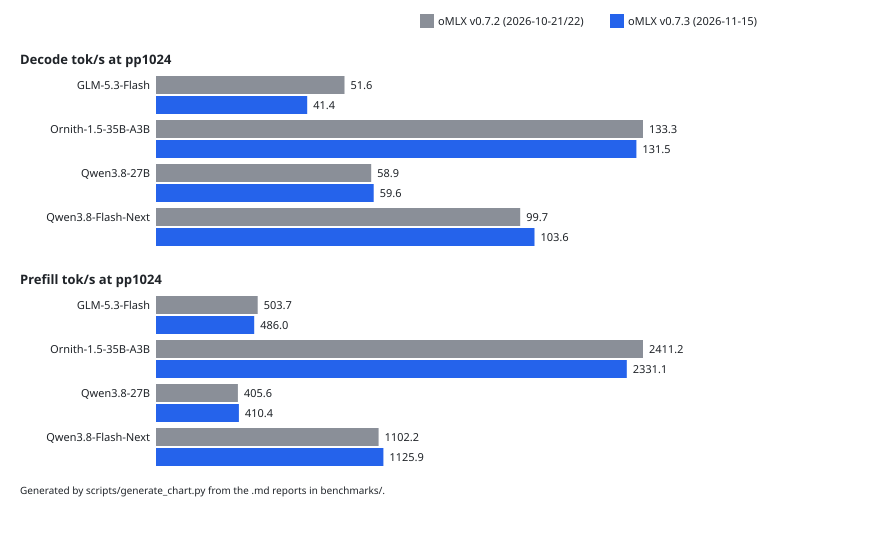

# local-agent-stack

My local agentic coding setup: open-weight LLMs served by oMLX on a Mac Studio, driven by [OpenCode](https://opencode.ai) with a multi-agent pipeline where each role gets the model that suits it. Nothing leaves the machine.

The pipeline gates themselves (plan approval, test evidence before review, reviewer round caps) are enforced by [turnstile](https://github.com/edseabolt/turnstile). This repo is the model and server side. The [`omlx-benchmark` skill](opencode/skills/omlx-benchmark/SKILL.md) runs oMLX's admin-API throughput benchmark (single-request prefill/decode at chosen context lengths, plus 2x/4x/8x concurrent batches) and prints README-ready tables; the [`omlx-install` skill](opencode/skills/omlx-install/SKILL.md) applies any template change to the live config.

## Contents

- [Hardware](#hardware)
- [Models](#models)
- [Agent roles](#agent-roles)
- [oMLX tuning](#omlx-tuning)
- [Setup](#setup)
- [Notes](#notes)
- [Benchmarks](#benchmarks)
- [License](#license)

## Hardware

- Mac Studio, M3 Ultra, 512 GB unified memory
- One oMLX server on port 8000, reachable on the LAN, API-key protected

## Models

All four are quantized with oMLX's oQ format, and all run with MTP (multi-token prediction) speculative decoding. See [Benchmarks](#benchmarks) for the full measured data.

| Model | Quant | Context | Input | Prefill tok/s | Decode tok/s | Notes |
|---|---|---|---|---|---|---|
| GLM-5.3-Flash | oQ6 | 256K in OpenCode (server allows 1M) | text, image | ~486–560 | ~41–71 | All agent roles run on it. Decode rises with context (41.4 at pp1024 → 70.6 at pp131072). |
| Qwen3.8-Flash-Next | oQ4 | 256K | text, image | ~1126–1358 | ~58–104 | Fastest flat prefill; defined but no agent role uses it today. |
| Ornith-1.5-35B-A3B | oQ8 | 256K | text, image, video | ~2331–3086, ~1108 at pp131072 | ~131–158, ~102 at pp131072 | MoE, ~3B active parameters. Fastest short-context model. Pinned in memory. Runs title and summary. |
| Qwen3.8-27B | oQ8 | 128K | text, image, video | ~410–435, ~271 at pp131072 | ~43–71, non-monotonic with context | Dense. Defined but no agent role uses it today. |

Full per-context tables, median and min–max, and methodology:
[docs/benchmarks-current.md](docs/benchmarks-current.md). Qwen3.8-Flash-Next and Qwen3.8-27B stay loaded and benchmarked, but no agent role points at them right now.

Server-side defaults for every model: temperature 1.0, top-p 0.95, top-k 20 (not set for GLM), thinking enabled with `reasoning_effort: low`. `force_sampling` is off, so the temperature OpenCode sends with each request wins. (oMLX also has a global fallback sampling profile for models without a per-model entry; the per-model values above are what matter here.)

## Agent roles

Defined in [`opencode/opencode.jsonc`](opencode/opencode.jsonc).

| Role | Model | Why |
|---|---|---|
| default, planner, plan-reviewer, executor, test-runner, reviewer, debugger | GLM-5.3-Flash (oQ6) | One model for every reasoning role keeps the prefix cache hot across turns. The 256K context holds a plan, diff, and test log at once. |
| title, summary | Ornith-1.5-35B-A3B | Cheap housekeeping calls. |

Each model also has three OpenCode variants: `precise` (0.1), `balanced` (0.5), and `creative` (0.9). turnstile further clamps executor, test-runner, and debugger to ≤ 0.2 and both reviewers to 0.

## oMLX tuning

From [`omlx/settings.json`](omlx/settings.json) and [`omlx/model_settings.json`](omlx/model_settings.json):

- **Memory:** balanced memory guard. (A 384 GB `memory_guard_custom_ceiling_gb` is set but only applies with tier `custom`, so it's inert here.)
- **Cache:** 35 GB hot (in-memory) prefix cache plus a 111 GB SSD cache directory (hot-cache-only mode is off). `preserve_mid_system_cache` keeps the shared system prompt cached across agent turns.
- **Scheduler:** 4 concurrent requests with chunked prefill, context-priority prefill, and decode fairness, so several agents (or several Orca worktrees) can share one server without one starving the others.
- **Decode:** aggressive burst decode, with the GPU kept warm every 0.5 s.
- **Context:** the server allows 256K per model (1M for GLM, 128K for Qwen3.8-27B). The OpenCode `limit.context` values are 256K for GLM, Qwen3.8-Flash-Next, and Ornith, and 128K for Qwen3.8-27B, so OpenCode compacts at 256K even though the GLM server entry allows 1M.

## Setup

1. Install oMLX and download the models into your oMLX models directory.
2. Run the install skill (or `python3 opencode/skills/omlx-install/scripts/install.py`): it creates `.env` (harvesting keys/hostname from an existing install, or generating them), substitutes the sentinels, backs up and installs `~/.omlx/settings.json`, `~/.omlx/model_settings.json`, `~/.config/opencode/opencode.jsonc`, and `~/.config/opencode/skills/`. The installed client config gets a literal `baseURL`/`apiKey`, so no `.env` sourcing is needed at launch.

3. Export `.env` if other tools need the values (`set -a; source .env; set +a`), then run `opencode`.

## Notes

- The server binds `0.0.0.0` so other machines on the LAN can use it. If you only use it locally, set `host` to `127.0.0.1`.
- The permission list auto-allows read-only shell commands (`git log`, `rg`, `jq`, and similar) plus `npm run *`, `gh *`, and a few low-risk utilities (`find *`, `sleep *`, `git branch *`, `git stash *`); destructive git operations (`git push * --force*`, `git worktree remove/prune`, `gh pr merge`) ask first, and everything else (edits, any other shell command) asks.
- `model_settings.json` also keeps entries for the unsuffixed base checkpoints (for example `GLM-5.3-Flash`). Only the `-oQ6-mtp` / `-oQ8-mtp` entries are used by this setup.

## Benchmarks

Throughput is measured with the `/omlx-benchmark` skill
(`opencode/skills/omlx-benchmark/`): 3 runs per model, single request at
four prompt lengths plus a 1x–8x batching sweep.

**Current — oMLX v0.7.3 (2026-11-15):** full tables — single-request cells
with mean ± stddev, median, and min–max (batching cells: mean ± stddev and
min–max) — plus methodology and per-model observations, in
[docs/benchmarks-current.md](docs/benchmarks-current.md).

**Historical — oMLX v0.7.2 (2026-10-21/22):** the previous run's tables
and observations, clearly labeled, in
[docs/benchmarks-historical.md](docs/benchmarks-historical.md).

Headline (single request, pp1024, decode tok/s, mean of 3):
GLM-5.3-Flash oQ6 41.4 · Qwen3.8-Flash-Next oQ4 103.6 ·
Ornith-1.5-35B-A3B oQ8 131.5 · Qwen3.8-27B oQ8 59.6.

## License

MIT
